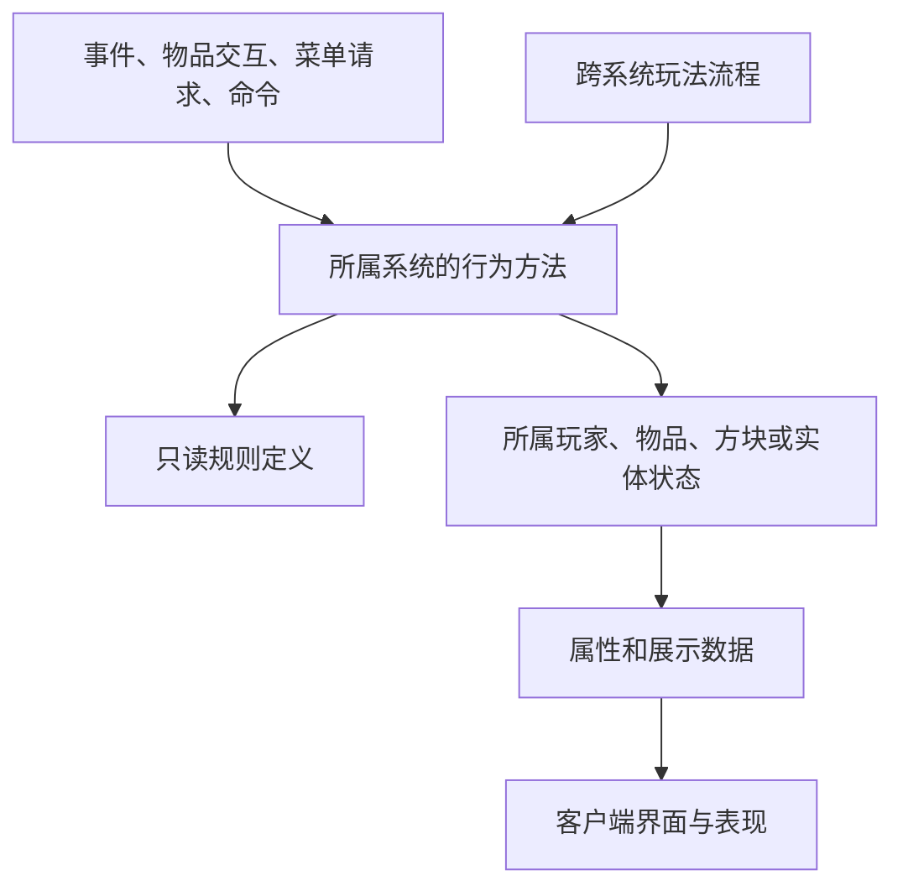

# 整体架构提案

状态：待负责人评审。以下是完整移植的组织方案，没有游戏代码实现。调查证据见 [1.18.2 版本架构调查](../reference/legacy/source-survey.md)。

## 工程形态

建议一个 Gradle Java 工程、一个 Mod 入口、一个发布 JAR，内部按玩法系统组织。目标为 Minecraft 1.21.1、NeoForge、Java 21；NeoForge 锁定本地已有源码的 21.1.228；开发环境的构建组合见“技术依赖”。

采用直接面向 1.21.1 的分系统重写。注册与资源保留来源映射，规则和状态按实际职责重建；不维护没有交付需求的中间 Minecraft 版本。两个 1.18.2 工程的全部内容都在范围内，分批只是实现顺序，详见 [实施顺序](roadmap.md)。

建议保留 `yvanchuxiuzhen` 与 `yvanchuxitong` 两个资源命名空间，使用一个 Mod 元数据入口。负责人 2026-11-02 确定 Mod ID 为 `yvanchuxiuzhen`、Java 基础包为 `net.yvanchuxiuzhen`；元数据 license 暂填 `All Rights Reserved`，待逐资产许可核对后再定，不视为最终授权决定。编号与含义分别记录，Java 名称采用可理解的语义名；遇到语义未核实的内容，暂保留来源编号。详见 [命名与台账](naming-and-catalog.md)。

## 源码调查直接决定的边界

| 源码事实 | 方案中的处理 |
| --- | --- |
| 功法书持有绑定者、等级、经验；玩家栏保存该物品 | 功法实例留在 ItemStack 组件，功法栏持有物品；不改为永久账户解锁库 |
| B 的同名功法字段未见显式外部访问，但有完整穴位/星宿学习小游戏 | 以真实入口确定功法栏；小游戏作为独立学习会话保留 |
| 材料袋数量保存在玩家隐藏 renwuitem，菜单主要展示分页 | 玩家材料仓独立持久化；从同一载体拆出任务数据和交易/对话会话 |
| 修为、待吸收修为、功法经验是不同数据；玩家 tick 分流修炼与功法研习 | 成长服务分别操作这些数值，闭关流程协调功法和成长，保留模式差异 |
| 炼器/炼丹/画符使用方块库存及职业快照 | 加工状态由装置拥有；开始操作时明确操作者与职业取值，预览只读同一套输入 |
| 银行字段在玩家档案；拍卖进度、商品及 NPC 竞价在方块状态 | 银行随玩家保存，现场拍卖由拍卖装置管理；不预设全服订单后台或离线转账平台 |
| 材料、药效、商品和任务混存于字符串、语言资源及 NBT | 按系统提取成结构化定义，显示文本与机器读取的配置分离 |
| 相同伤害字段存在写入和未闭合的消费链 | 按真实事件和命中入口接入战斗服务；记录断链，不能仅按字段名宣称效果可用 |
| 妖兽包含形态切换、弹体、驯服、采集与 GeckoLib 动画 | 按完整实体族迁移，玩法状态由实体保存，动画消费表现状态 |

以上是架构边界建议，不替负责人裁定源码中的错误、断链或数值冲突。

## 系统所有权

| 系统目录 | 完整职责 | 自己拥有的数据 | 对外合作 |
| --- | --- | --- | --- |
| `cultivation` 修炼成长 | 出生、种族、灵根/体质、境界、修为、寿元、金丹、元婴、雷劫和轮回 | 玩家成长档案、成长会话 | 读功法与药效贡献；向属性提供基础值；雷劫通过战斗/能力执行 |
| `gongfa` 功法 | 生成、绑定学习、装备、闭关研习、升级、参悟、继承及特殊功法 | 功法定义、书籍实例组件、功法栏 | 提供成长修正与属性贡献；特殊效果使用能力入口 |
| `attributes` 属性 | 基础属性、来源贡献、派生上限、实际实体属性、显示值 | 派生结果与必要缓存 | 功法、装备、成长提供输入；战斗和界面读取结果 |
| `combat` 战斗与关系 | 伤害阶段、元素/物理/精神结算、抗性、状态、敌友/队伍、击杀结果 | 关系数据、战斗运行态 | 接收技能、法宝、符箓、阵法、生物的命中；供任务/成长消费结果 |
| `abilities` 技能与移动 | 技能栏、神通、武器技、连招、轻功、飞行、弹体、施法与冷却 | 技能定义、装备物品、施法状态 | 成长资源扣除、战斗命中、客户端动作表现 |
| `equipment` 装备与法宝 | 武器、防具、饰品、本命法宝、词条、耐久、培养与装备槽 | 装备实例组件、专属槽位、本命关系 | 炼器生成实例；属性读取贡献；技能消费法宝能力 |
| `materials` 材料 | 编号材料身份、品阶/等级/重量等共有定义、采集职业规则 | 材料定义及实例覆盖、采集进度 | 世界和生物产出；炼器/炼丹/符箓/阵法各自解释专用用途 |
| `alchemy` 炼丹与药物 | 药材效果运算、丹方、开炉、炸炉、分丹、合丹、药理台、容器服用及毒药 | 药效定义、丹药组件、丹炉状态、炼丹进度 | 材料输入；向成长/属性/战斗施加实际药效 |
| `refining` 炼器 | 图纸、鼎炉、熔炼、炼制、升级、精炼、修理及词条生成 | 图纸定义、炉次状态、炼器进度 | 读取材料；生成 equipment 的器物实例 |
| `talismans` 符箓 | 符头/符胆知识、绘制、烧灰、成品、释放和持续效果 | 解锁状态、符箓组件、符台状态、符箓职业 | 读材料与条件；调用能力/战斗/成长等确定效果 |
| `formations` 阵法 | 阵位、阵元材料、检测、等级、能量、红石/感应/阵旗启动及传送 | 阵基/阵元状态、旗帜绑定 | 读取材料，调用能力、关系、成长与世界传送 |
| `creatures` 生物与驯养 | 妖兽、Boss、普通生物、各形态、AI、掉落采集、灵兽袋、蛊虫与傀儡相关实体 | 实体等级/主人/成长/形态，培养状态 | 世界投放、战斗、技能、材料与容器 |
| `npc` 修士交互 | 修士身份、AI、交互、对话、知识问答、现场 NPC 参与 | NPC 实例与对话会话 | 经济负责成交，任务负责推进，战斗负责敌友和伤害 |
| `economy` 交易经济 | 多种货币、存取兑换、NPC/方块商店、价格调整、现场拍卖与收购 | 个人银行、商品定义、装置库存/拍卖状态 | 任务发奖和 NPC 交互调用明确的交易操作 |
| `quests` 任务推进 | 接取、条件、对话动作、悬赏、进度、奖励和成就接入 | 玩家任务状态、公共悬赏数据 | 订阅有实际需求的行为结果；调用所属系统发放奖励 |
| `world` 世界场景 | 维度、群系、矿物/植被生成、结构、城镇、副本、传送/回程、场景管理工具 | 世界定义、维度/全局实例状态 | 投放材料、生物、设施和任务入口；保留编辑工具能力 |
| `life` 生活生产 | 种植生长、食材、饮食/酒、各类锅具、缝纫、木工、装订、家具交互 | 生活定义、装置状态、相关职业进度 | 使用材料、书籍和容器；向成长/属性提供已有规则的效果 |
| `storage` 特殊容器 | 乾坤袋、陶罐、玩家材料仓等容量、过滤、转移与保存 | 普通库存随物品/方块/实体；材料计数仓随玩家 | 为各系统提供真实库存/数量操作；不拥有其生产配方或交易规则 |
| `knowledge` 公共书籍 | 书籍载体、阅读、内容分类和学习入口分派 | 公共书籍内容定义 | 功法、技能、图纸、丹方、符箓分别保存自己的知识/实例状态 |

御鬼、尸道、血术、御虫等全部保留调查与移植项；依据真实状态与入口分别落入功法/能力、生物及职业子系统。仅存在职业等级字段，不能推断已有完整独立玩法。上述清单是职责划分，不是可选安装模块清单。

19 个系统已有 [独立调查正文](../systems/README.md)，分别记录真实入口、载体、目标操作和未裁定差异。全部 7,465 个来源元素及 7,874 个 Java 类已有候选归属；候选归组不等于逐内容语义已批准。

## 调用与代码组织



系统内部直接调用具体类的方法。跨系统只调用该系统明确公开的行为方法或查询，不持有其他系统的可写存档对象。只有确实存在多种实现、替换或依赖反向的需求时才引入接口；不为每个类建立对应 interface。

跨系统流程集中在少量具体协调类，例如闭关推进协调成长与功法，击杀结果协调任务与成长。属性计算收集功法/装备等输入后计算结果，属性公式本身不反向扫描每个系统。协调代码不建立通用事件总线、反射插件、全局服务定位器或事务引擎。

实际事件/菜单/消息/命令、跨系统依赖方向、动态数据族和客户端隔离统一在 [公共入口与依赖](entry-and-dependency.md)维护。

基础类型、编码和库存操作只有在实际复用后进入 `shared`。重复的材料数据可以抽成定义；不同的 Boss 行为、特殊功法和生产规则保留明确实现，不能为了通用化丢失例外。

```text
src/main/java/<项目包>/
  ModMain.java                    注册与生命周期装配
  shared/                         已确认共用的类型与工具
  gameplay/                       确实跨系统的具体流程
  systems/<system>/               本系统内容、数据、规则和行为
    data/                         定义、实例、序列化（按需要拆分）
    content/                      物品、方块、实体及注册
    menu/                         服务端菜单和操作入口
    ...                           简单系统直接平铺，复杂系统按职责拆分
  client/<system>/                屏幕、HUD、按键、模型、动画和粒子
src/main/resources/
  assets/yvanchuxiuzhen/          保留来源资源身份
  assets/yvanchuxitong/
  data/yvanchuxiuzhen/
  data/yvanchuxitong/
tools/porting/                    编号/变量提取、资源映射、批处理
tools/docs/                       文档与导出维护
docs/                            设计、开发指南、系统正文及证据
```

目录表示批准后的目标布局，本轮没有创建 Java 空壳。注册接线按系统声明，入口类负责装配；不把所有注册项或全部 tick 行为放进一个巨型类。公共代码的签名与静态初始化不得引用客户端类。

## 技术依赖

开发环境（负责人 2026-11-02 授权先行建立）：Gradle 8.8 wrapper、ModDevGradle 2.0.141、NeoForge 21.1.228、Parchment 1.21.1 / 2024.11.17、Java 21 toolchain。Parchment 版本取自其 maven 元数据中 1.21.1 的最新正式版；ModDevGradle 采用本机已有且已在邻近工程使用的版本，不声称为最新。元数据由 `src/main/templates` 展开，版本与 ID 只在 `gradle.properties` 维护。当前只有加载入口 `net.yvanchuxiuzhen.YvanchuxiuzhenMod`，不注册任何内容；第三方库在所属系统实施时按实际需求加入。

GeckoLib 是已发现的真实动画依赖：1.18.2 妖兽类直接实现 `IAnimatable`，还存在 230 个 geo 与 233 个 animation 文件。建议采用支持目标版本的 GeckoLib 并迁移动画控制器；具体版本和运行验证待构建阶段锁定，不能仅依据元数据的 optional 标记忽略依赖。

Photon、LDLib、PlayerAnimator 不作为既定依赖。若完整恢复某项表现确实需要这些库，应先记录来源效果、所需能力及具体兼容版本，再纳入方案。原生菜单和渲染能够承担的内容直接使用目标 API。

方案代价主要是重新梳理字符串配置、分离状态所有权、重写跨端入口与迁移实体动画。收益是能逐项核对行为且可定位改动影响。新增抽象数量不作为架构质量或移植进度指标。

数据流见 [数据与运行时](data-and-runtime.md)，编码约束见 [开发规则](coding-policy.md)，全部范围的实施与验收见 [路线](roadmap.md)。
