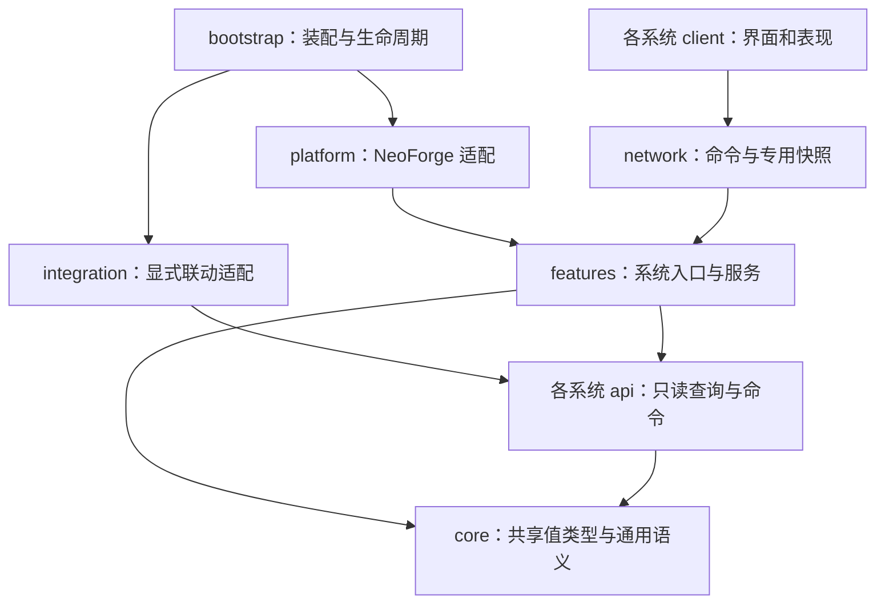

# 整体架构

## 形态与边界

建议采用一个 Gradle Java 工程、一个 Mod 入口、一个发布 JAR，以包级模块划分职责。首轮不拆成二十个 Gradle 子工程，也不构建可热插拔的模块平台。逻辑模块不等于可独立禁用的 Mod；全部内容随整包交付。

目标固定为 Minecraft 1.21.1 / Java 21；NeoForge 先以已存在本地源码的 21.1.228 作为拟用技术基线。构建阶段再验证具体 Gradle 插件、映射与依赖组合，不从邻近工程复制跨 MC 版本的 Parchment 配置。默认先使用该目标的官方映射。

架构解决四个问题：每份状态只有一个所有者；每条行为有明确服务端入口；跨系统联动有显式调用；每份旧内容有来源和验收结果。现阶段没有实现下列类或接口，名称用于表达职责。

## 依赖方向



图是层次规则，不表示任意 feature 可以任意调用所有 api。具体系统依赖必须登记并保持无环；下表的“输入/联动”是运行时关系，双向关系通过组合层注入回调接口或消费结果连接，不形成双方实现包互相 import。

- `core` 不依赖 feature、客户端类或第三方渲染/UI 库。只放资源身份、五行、境界编号、数量/结果等确实共享的基础类型，不放所有玩家字段。
- 各系统的 `api` 由该系统拥有，暴露不可变视图、显式命令和结果；禁止公开可写存档对象、库存引用和内部缓存。
- 规则计算尽量可脱离游戏运行；需要实体、方块与世界的服务使用明确上下文，不追求把所有 Minecraft 类型包装一遍。
- 生产系统通过装备/药效等公开产物契约生成结果；战斗系统消费结果，不反向调用生产过程。
- 对存在反向需求的联动，消费者定义窄接口，由 `integration` 装配提供者。例如功法提交属性贡献，战斗公布结算结果；两个实现包不互调。
- 仅在跨系统边界引入接口，系统内部直接调用。不得为每个类都配置 interface、通用事件总线、反射扫描或全局 service locator。
- 游戏公共类不静态引用客户端类；客户端启动、renderer 与 screen 接线由客户端入口完成，并以专用服务器启动验证。

建议允许的直接跨模块依赖如下；同表未列出的依赖不默认放行。被依赖方的 `api` 只能使用自己的公开值类型、core 与必要平台类型，不能反向 import 调用方。其余跨系统合作由消费者定义窄接口、integration 提供实现。

| 调用方 | 可直接依赖的其他系统 api |
| --- | --- |
| cultivation、attributes、storage、knowledge、world | 无；外部贡献/能力由显式注入端口接入 |
| equipment | attributes |
| combat | attributes |
| abilities | combat |
| gongfa | attributes、abilities |
| alchemy | cultivation、attributes、combat |
| refining | equipment、storage |
| talismans、formations | abilities |
| creatures | abilities、combat |
| economy | storage |
| quests | cultivation、economy、storage |
| npc | combat、economy、quests |
| life | cultivation、storage |

例：abilities 定义资源扣费端口，integration 将其接到 cultivation；cultivation 的雷劫端口由 integration 接到 abilities；这两个运行时方向可以同时存在，但实现包没有双向编译依赖。端口只承载命令与结果，调用链必须有状态机/阶段约束，依赖倒置不等于允许无限互相回调。

基础实现阶段增加包依赖检查：拒绝跨模块 `service/storage/client` import、api 暴露实现类型及模块依赖环；公共启动检查还需覆盖字符串反射等静态 import 无法识别的入口。当前仅有规则，没有已通过的代码检查。

## 模块职责

以下是建议的职责划分，同一模块可以包含几个紧密关联的子功能；数量不用于衡量移植进度。

| 模块 | 唯一负责的状态与规则 | 输入、输出和联动 |
| --- | --- | --- |
| `cultivation` 修炼成长 | 境界、修为/待吸收池、寿元、出生/灵根/体质、金丹/元婴/轮回与成长规则 | 公开成长查询与增量命令；功法、丹药、战斗、任务提供来源；雷劫由边界接口协作 |
| `attributes` 属性合成 | 属性语义、来源合成、派生上限与应用规则 | 消费功法、装备、丹药等不可变贡献；输出实体属性与专用快照，不持有其原始进度 |
| `combat` 战斗与关系 | 伤害类型、结算次序、关系判定、护盾/状态作用接口、伤害结果 | 普攻、神通、阵法、妖兽共用规则；旧版例外显式策略化，不能统一公式后抹平差异 |
| `gongfa` 功法 | 功法定义、已学实例、装备、经验/等级、继承、特殊规则 | 读取境界；输出属性贡献、能力授权、修炼修正；禁止在 GUI 中保存第二份功法 |
| `abilities` 技能与移动 | 技能/神通/武器技/轻功/飞行的定义、装备、冷却、执行和命中阶段 | 通过资源命令扣费、通过战斗结算；位移和动画分别由服务端与客户端负责 |
| `equipment` 装备与本命 | 装备实例、词条、耐久、饰品槽、本命绑定与培养 | 炼器产物进入本模块；法宝技能调用能力接口；饰品有明确槽位与属性收集入口 |
| `alchemy` 炼丹 | 丹方、药材作用、炼丹/分丹/合丹/药理台、职业进度、药效实例 | 输出可服用/可消费药物；药效经成长、属性、状态接口生效 |
| `refining` 炼器 | 材料加工、图纸、鼎炉模式、炉次、炼器经验、熔炼/精炼/修理 | 输入材料与职业门槛；输出装备契约；同一炉次由一个状态机管理 |
| `talismans` 符箓 | 符头符胆、绘制/烧灰、职业进度、符箓实例及使用规则 | 输入知识和材料；效果调用能力/状态接口，制作与释放属于同一模块责任链 |
| `formations` 阵法 | 阵位、材料解释、结构检测、能源、旗帜绑定、阵法会话 | 调用效果、成长与传送接口；检测成本与效果执行分离；不创建第二套伤害公式 |
| `creatures` 生物 | 妖兽、Boss、普通生物、形态、AI、采集、驯养/培育及实体存档 | 自然生成由世界投放装配；技能和掉落对接已有接口；蛊虫/傀儡等按旧链核实后归属 |
| `npc` 修士与交互 | NPC 身份、行为、对话、见闻、关系与交互入口 | 商品查询/成交交给经济；任务授予交给任务；不能在对话 UI 直接发奖 |
| `economy` 经济 | 货币、银行账户、兑换、商店库存、报价、拍卖与结算记录 | NPC/方块/任务作为调用方；成长门槛通过查询接口，库存与余额由服务端交易入口修改 |
| `quests` 任务与推进 | 接取、条件、进度、悬赏、成就、奖励领取状态 | 消费已提交行为结果；调用奖励交付接口；不通过扫描所有玩家字段猜测完成 |
| `world` 世界与场景 | 维度、群系、结构、矿物/资源投放、城镇/副本及传送 | 资源定义和实例状态分开；传送受世界/区块生命周期约束，场景规则不混入客户端 |
| `life` 生活生产 | 作物、烹饪、饮酒、缝纫、木工、装订、家具操作与相关职业 | 公共库存设施可复用，但配方、消耗、奖励仍由各玩法拥有 |
| `storage` 容器 | 乾坤袋、材料袋、特殊容器的容量、过滤和存储服务 | 通过公开物品处理边界接入生产/交易；容器不拥有材料属性或玩家职业真值 |
| `knowledge` 书籍与知识 | 公共书籍载体、内容判别、阅读、教程/解锁键 | 学习功法、丹方、图纸等派发给拥有者；不重复保存其经验与装备 |

后期内容不能因表内未单列而遗漏。御鬼、尸道、血术、御虫、培育、傀儡、附器等先作为旧功能清单项追踪：若是功法特效，归功法/能力；若有独立实体与培养存档，再设专责子系统。不能只因旧 PlayerVariables 存在职业字段就发明一个完整职业。

雷劫是成长与战斗协作的专项子系统；法宝是装备与能力协作的专项子系统。它们各有独立文档和运行状态，但不复制属性、伤害与物品存档基础设施。

## 推荐目录

以下为待实现目录，不是当前已生成的代码：

```text
src/main/java/com/shane/yuanchuxiuzhen/
  bootstrap/                 唯一装配入口、公共和客户端启动
  core/                      确认共用的值类型与结果语义
  platform/neoforge/         附件、网络、事件、重载与注册机制适配
  integration/               跨系统端口实现与显式联动装配
  features/<system>/
    api/                     对外查询、命令和结果
    model/                   定义与实例值对象
    rules/                   无副作用公式和规则
    service/                 权威行为入口与状态转换
    storage/                 持久化编码、版本迁移与仓储适配
    content/                 本系统物品、方块、实体及注册
    network/                 本系统命令、快照与增量
    client/                  屏幕、渲染、音效与视觉状态
src/main/resources/assets/<旧命名空间>/
src/main/resources/data/<旧命名空间>/
tools/porting/                静态提取、ID 映射、资源核对
docs/systems/<system>/       玩法、架构、数值、状态和日志
```

目录按实际需要建立，简单系统不强制拥有全部子目录。每个系统声明自己的注册项，bootstrap 只负责显式调用装配方法。避免一个数千行 Items/Events 类掌握全项目逻辑；生成的注册代码也按所有者分文件。

## 三条关键调用链

**学习与修炼**：书籍使用入口验证物品 → knowledge 解释内容 → gongfa 验证与记录学习 → cultivation 按旧版会话规则推进修为/待吸收池 → 属性来源变更时重算 → 定向发送展示快照。功法学习状态始终只有一份。

**炼器与装备**：鼎炉菜单命令 → refining 校验实际槽位和职业条件 → 规则引擎计算预览/执行计划 → 开始炉次并记录投入 → 提交成品到输出槽 → equipment 解码装备实例 → attributes/combat 消费词条。预览只展示结果，不持有真实库存和随机奖励。

**击杀、任务与经济**：combat 提交伤害并确认击杀 → 明确结果交给成长/任务联动 → 任务服务检查完成与领奖状态 → 奖励交付到经济或库存 → 更新对应状态和快照。同一语义入口不同时由多个底层受伤事件重复触发；具体判定随旧版链路核对。

## 依赖与成本

NeoForge 是必需平台。GeckoLib 在旧资源确实依赖时选定 1.21.1 兼容版本；旧版标记可选不能证明所有资源都无依赖。LDLib、Photon、PlayerAnimator 等不从已有移植工程自动带入；在最小 UI/模型/特效原型显示必要性后再锁定，并限制在适配层。

收益是规则可追踪、存档可迁移、单个系统可独立核对；成本是需要编写少量边界适配和生命周期测试。公共层过大、跨系统接口过密同样会造成混乱，因此不提前创建全功能框架。性能设计及多玩家一致性见[数据与运行时](data-and-runtime.md)。

实现状态：设计草案；尚未编译、启动或验证依赖无环。
