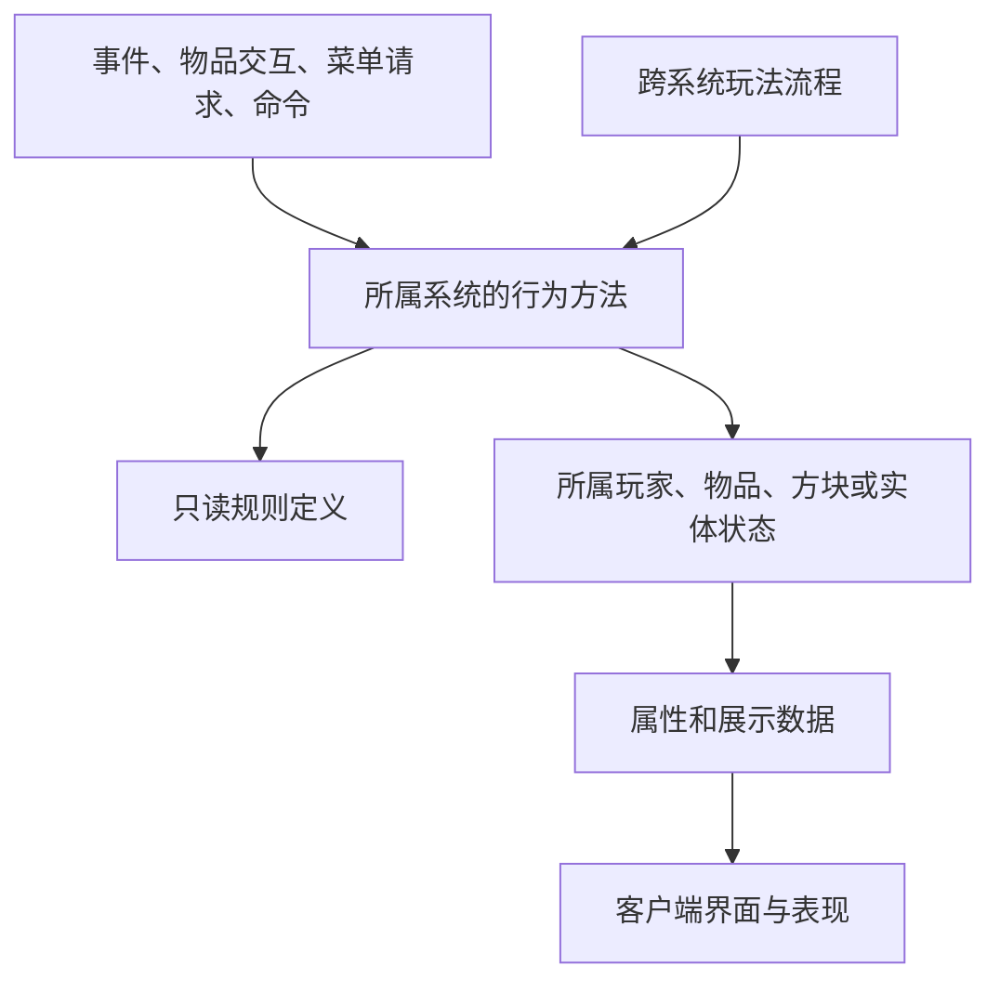

# 整体架构

状态：负责人 2026-11-02 批准（main 提交 `3e0585c` 版本）；同日批准的[系统设计](system-design.md)改写了“系统所有权”一节。批准不含存档导入、界面复刻程度、license 与来源矛盾 Q01–Q14，这些仍待裁定；文中“建议”表述在本文范围内按已采用执行，与之相关的未决事项除外。当前只有开发环境与加载入口，没有玩法代码。调查证据见 [1.18.2 版本架构调查](../reference/legacy/source-survey.md)。

## 工程形态

建议一个 Gradle Java 工程、一个 Mod 入口、一个发布 JAR，内部按玩法系统组织。目标为 Minecraft 1.21.1、NeoForge、Java 21；NeoForge 最低支持 21.1.228，构建使用 21.1.265；开发环境的构建组合见“技术依赖”。

采用直接面向 1.21.1 的分系统重写。注册与资源保留来源映射，规则和状态按实际职责重建；不维护没有交付需求的中间 Minecraft 版本。两个 1.18.2 工程的全部内容都在范围内，分批只是实现顺序，详见 [实施顺序](roadmap.md)。

全部注册与资源使用一个命名空间 `yvanchuxiuzhen`，与 Mod ID 相同；原初系统的内容由 `yvanchuxitong:<路径>` 改为 `yvanchuxiuzhen:<路径>`（负责人 2026-11-02 决定，取代原“保留两个命名空间”）。两个来源同名的注册与资源按[工程结构](engineering.md)“注册与内容表”“资源转换管线”处理；1.18.2 ID 只在决定导入存档后以注册表别名承接。负责人 2026-11-02 确定 Mod ID 为 `yvanchuxiuzhen`、Java 基础包为 `net.yvanchuxiuzhen`；元数据 license 暂填 `All Rights Reserved`，待逐资产许可核对后再定，不视为最终授权决定。编号与含义分别记录，Java 名称采用可理解的语义名；遇到语义未核实的内容，暂保留来源编号。详见 [命名与台账](naming-and-catalog.md)。

## 源码调查直接决定的边界

| 源码事实 | 方案中的处理 |
| --- | --- |
| 功法书持有绑定者、等级、经验；玩家栏保存该物品 | 功法实例留在 ItemStack 组件，功法栏持有物品；不改为永久账户解锁库 |
| B 的同名功法字段未见显式外部访问，但有完整穴位/星宿学习小游戏 | 以真实入口确定功法栏；小游戏作为独立学习会话保留 |
| 材料袋数量保存在玩家隐藏 renwuitem，菜单主要展示分页 | 玩家材料仓独立持久化；从同一载体拆出任务数据和交易/对话会话 |
| 修为、待吸收修为、功法经验是不同数据；玩家 tick 分流修炼与功法研习 | 成长服务分别操作这些数值，闭关流程协调功法和成长，保留模式差异 |
| 炼器/炼丹/画符使用方块库存及职业快照 | 加工状态由装置拥有；开始操作时明确操作者与职业取值，预览只读同一套输入 |
| 银行字段在玩家档案；拍卖进度、商品及 NPC 竞价在方块状态 | 银行随玩家保存，现场拍卖由拍卖装置管理；不预设全服订单后台或离线转账平台 |
| 材料、药效、商品和任务混存于字符串、语言资源及 NBT | 按系统提取成结构化定义，显示文本与机器读取的配置分离 |
| 相同伤害字段存在写入和未闭合的消费链 | 按真实事件和命中入口接入战斗服务；记录断链，不能仅按字段名宣称效果可用 |
| 妖兽包含形态切换、弹体、驯服、采集与 GeckoLib 动画 | 按完整实体族迁移，玩法状态由实体保存，动画消费表现状态 |

以上是架构边界建议，不替负责人裁定源码中的错误、断链或数值冲突。

## 系统所有权

系统清单、类别（基座、编排、汇总、内容族）、归属判定、依赖规则与公开操作以[系统设计](system-design.md)为正文（2026-11-02 批准，取代本节原有的 19 系统表）。要点：系统之间不得相互依赖；依赖由职责与数据归属决定，不按来源访问量推导；内容归属读来源规则确定，目录与名称只给候选。

各系统的调查正文在 [docs/systems](../systems/README.md)，分别记录真实入口、载体、目标操作和未裁定差异。全部 7,465 个来源元素及 7,874 个 Java 类在[归属表](../reference/legacy/inventory/ownership_assignment.csv)中有归属，状态为“候选”的行不作为实现依据。

## 调用与代码组织

系统内部直接调用具体类的方法。跨系统只调用该系统明确公开的行为方法或查询，不持有其他系统的可写存档对象。只有确实存在多种实现、替换或依赖反向的需求时才引入接口；不为每个类建立对应 interface。

跨系统流程集中在少量具体协调类，例如闭关推进协调成长与功法，击杀结果协调任务与成长。属性计算收集功法/装备等输入后计算结果，属性公式本身不反向扫描每个系统。协调代码不建立通用事件总线、反射插件、全局服务定位器或事务引擎。

实际事件/菜单/消息/命令、跨系统依赖方向、动态数据族和客户端隔离统一在 [公共入口与依赖](entry-and-dependency.md)维护。

重复的材料数据可以抽成定义；不同的 Boss 行为、特殊功法和生产规则保留明确实现，不能为了通用化丢失例外。玩法共享值类型放在所有者系统的 `api`，平台适配只在至少两个系统实际共用后进入 `platform`。

代码目录、客户端入口、边界自动检查、内容表、资源转换、台账工具与并行协作规则以[工程结构与长期维护](engineering.md)为正文。入口类只按依赖顺序调用各系统装配，不把所有注册项或全部 tick 行为放进一个巨型类；公共代码的签名与静态初始化不得引用客户端类。

## 技术依赖

开发环境（负责人 2026-11-02 授权先行建立，B0 步骤 1 更新）：Gradle 8.8 wrapper、ModDevGradle 2.0.148、NeoForge 21.1.265（`neoforge.mods.toml` 范围 `[21.1.228,21.2)`，下限为负责人决定的最低支持版本）、Parchment 1.21.1 / 2024.11.17、Java 21 toolchain。NeoForge 与 ModDevGradle 取 2026-11-02 maven 元数据中的最新版；Parchment 版本取自其 maven 元数据中 1.21.1 的最新正式版。元数据由 `src/main/templates` 展开，版本与 ID 只在 `gradle.properties` 维护。当前有公共入口与客户端入口，各 Setup 只登记空注册器。测试类路径另有 ArchUnit 1.5.1、JUnit Jupiter 5.10.2 与 JUnit Platform Launcher 1.10.2，版本在 `gradle.properties` 维护，不进入发布 JAR。

GeckoLib 是已发现的真实动画依赖：1.18.2 妖兽类直接实现 `IAnimatable`，还存在 230 个 geo 与 233 个 animation 文件；不能仅依据元数据的 optional 标记忽略。Photon、LDLib、PlayerAnimator 不作为既定依赖。依赖准入、版本声明、更新时机与目标源码位置按[工程结构](engineering.md)的“依赖治理”执行。

方案代价主要是重新梳理字符串配置、分离状态所有权、重写跨端入口与迁移实体动画。收益是能逐项核对行为且可定位改动影响。新增抽象数量不作为架构质量或移植进度指标。

数据流见 [数据与运行时](data-and-runtime.md)，编码约束见 [开发规则](coding-policy.md)，全部范围的实施与验收见 [路线](roadmap.md)。
