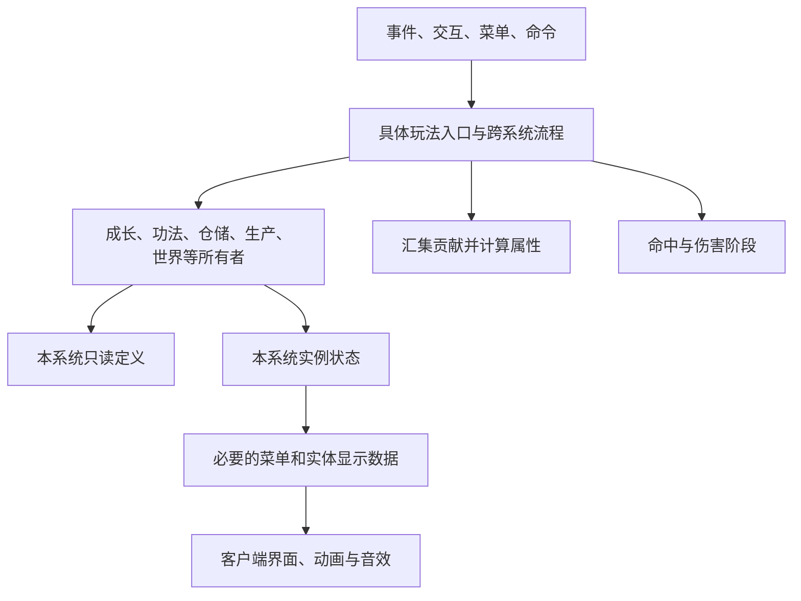

# 公共入口、依赖与动态数据调查

本稿连接 [19 个系统正文](../systems/README.md)与[数据生命周期](data-and-runtime.md)。来源 A/B 的定位方式见系统导航；目标调用方式均为提案。

## 全量入口的证据范围

| 来源表面 | 已建立的索引 | 能确认与不能确认的内容 |
| --- | --- | --- |
| Java 与编辑器源 | 7,874 类，7,465 个元素，14,005 条元素文件关联 | 覆盖两个工程；元素、类、注册项、玩家功能是不同口径 |
| Procedure 调用 | 3,428 个过程，7,683 处调用及参数 | 记录调用者方法和跨 Mod 目标，不解析全部分支可满足性 |
| Blockly 图 | 3,428 个过程的连接调用集合与生成 Java 对照 | 同 Mod 直接过程调用集合差异为 0；192 个过程另有游离调用节点。条件、调用次数、参数和运算次序尚不能据此认定等价 |
| 事件 | 531 个注解方法，其中 372 位于识别到的自动订阅类，159 不在该类形态中 | 含平台注册、渲染、世界生成和动态内部监听；不是 531 个全局玩法 tick |
| 网络 | 86 个消息类 | 按键、菜单、文本及数据消息；当前属性是词法匹配，仍需以真实处理入口确定检查范围 |
| 菜单 | 92 类及库存容量/绑定/关闭方法 | addSlot 语句数不等于槽位数量；显示槽不自动视为玩家库存 |
| 命令 | 22 类，另有 402 处命令执行 | 自定义伤害、任务选择、传送和管理操作需沿命令继续追踪 |
| 间接引用 | 1,410 处注册表查询、574 处翻译查询 | 语言查询同时包含文案与机器配置；注册 ID 可能由运行数据组成 |
| 延迟监听 | 129 个手动注册点与 129 个解除点 | 数量相等不证明退出、卸载或取消时都正确解除 |

来源：[结构汇总](../reference/legacy/inventory/architecture_summary.json)、[编辑器对照](../reference/legacy/inventory/source_design_summary.json)、[索引导航](../reference/legacy/inventory/README.md)。

结构入口图从自动订阅类及非 Procedure 类的直接调用出发，可到达 3,342 个过程，另 86 个未到达。这是类级上界：调用方是否已注册、分支是否满足、动态命令与运行脚本是否另有入口，仍需分别检查。未到达条目保留在全量范围内，不自动删除；到达条目也不自动标记有效。

## 入口如何进入目标系统

| 入口 | 来源实例 | 目标处理 |
| --- | --- | --- |
| 登录、复制、离场 | A/B Variables，B PlayerJoinGame | 所属系统加载/复制档案；分别处理普通死亡、非死亡复制、轮回和会话结束 |
| 玩家 tick | A PlayerTick、B PlayerTickxitong | 按实际周期推进成长、施法、任务等；跨系统顺序由具体流程协调，保留来源顺序和随机调用次数 |
| 物品/方块交互 | 功法书、鼎炉、阵旗、容器 | 当前玩家及真实实例进入所属系统；客户端提供操作意图 |
| 菜单请求 | TripodGUIButtonMessage 等 | 从当前服务端菜单取得绑定对象和输入，执行生产/交易/学习操作；独立显示快照不作为资产 |
| 战斗事件和命中 | EntityHurt、EntityBeforeHurt、ShanghaiGo、弹体命中 | 先区分原生伤害与自定义结算，再映射目标伤害阶段；同一份伤害只计算一次 |
| 实体/方块推进 | 妖兽 AI、丹炉、拍卖、阵基、副本方块 | 所有者推进自身阶段，完成后交给具体跨系统流程；临时对象的结束由其所有者处理 |
| 世界初始化和数据加载 | Worldbegin、NPC 目录、生成注册 | 分开静态定义、维度/全局实例和管理覆盖；保留初始化实际时机 |
| 命令、对话与管理 | /shanghai、/taskduihua、场景编辑 | 与普通入口使用相同系统方法；保留命令参数、执行主体和权限的来源证据 |
| 客户端输入/表现 | 15 按键元素、3 覆盖层、屏幕和动画 | 输入发往服务端；界面读取快照；动画、声音和粒子消费已发生的状态与表现消息 |

NeoForge 接口依据见 [本地源码核对](../reference/target-api.md)。以上是职责边界，未为每个入口创建接口类、事件总线或空服务。

## 跨系统调用方向

来源 [66 组跨归属调用](../reference/legacy/inventory/module_dependencies.csv)用于发现耦合，不直接成为目标允许依赖。归组基于来源目录和人工例外，仍属提案。

| 具体流程 | 所有者及调用方向 | 避免互相持有的可写数据 |
| --- | --- | --- |
| 装备与属性重算 | 装备/功法/成长产出贡献值 → 协调入口 → attributes 计算并应用 | attributes 不反向修改书籍或玩家成长档案 |
| 闭关与功法研习 | 闭关流程依模式调用 cultivation 或 gongfa | 书籍经验留在书籍，修为与待吸收池留在玩家 |
| 施法、符箓与阵法命中 | 所属执行器 → cultivation 扣资源、combat 结算；需要传送/召唤时调用具体 world/creatures 操作 | combat 不读取任意物品标签推断全部技能；效果执行后返回所需结果 |
| 制造与自动取料 | alchemy/refining/talismans/life → materials 查询、storage 取料 → 产物所属系统构造实例 | 仓储不拥有职业、配方和产物公式 |
| 击杀、采集和成长 | 实际结算结果 → 具体流程 → quests/cultivation/materials | combat/creatures 不依赖任务脚本细节 |
| NPC 交互 | npc 提供实例与入口 → economy 或 quests；对话奖励经具体流程调用所属系统 | NPC 不复制玩家账户、任务及仓储数据 |
| 场景与刷怪 | world 场景流程 → creatures 初始化；结束结果交给任务/成长流程 | 生物不写世界定义目录，场景不复制实体属性公式 |
| 公共书籍 | knowledge 分派入口 → 功法/技能/图纸/丹方/符箓所属系统 | knowledge 不承担统一永久解锁库 |

实现中先用明确的方法和返回值；有实际多种实现需求才引入接口。双向玩法关系由具体协调入口完成，不能用全局可写 CompoundTag、服务定位器或通用回调绕开所有权。定义引用内容 ID 和运行时调用服务是不同关系，注册装配统一处理前者。

## 菜单与会话的实际归属

| 来源菜单/流程 | 已确认结构 | 目标状态边界 |
| --- | --- | --- |
| A PlayerGUI04 | 8 个自定义槽；0/1/2/7 为功法/轻功/飞行/武器技，3–6 按四页映射 16 技能 | 所属系统保存真实物品；当前页和界面临时槽单独处理，关闭必须有确定去向 |
| A 乾坤袋 01–04 | 27/54/108/220 格；来源模板可绑定物品、实体或方块 | 实际交互入口决定载体，不能只看菜单类的通用分支 |
| B CailiaodaiGui | 46 格，1 输入 +45 分页显示 | 玩家计数仓是真值；显示物品由数量记录构造；详见 storage 正文 |
| B TripodGUI / LiandanGUI | 各 11 个自定义槽，输入/燃料/产物的职责由过程消费决定 | 装置库存及炉次归装置；玩家、职业快照和操作会话不能混为共享临时数值 |
| B BankGUI | 11 个自定义槽，其中存款过程遍历前 10 格 | 账户归玩家，槽内物品与账户数量分别完成转移 |
| B GongfaxvexiGui | 无物品槽，通过穴位/星宿图交互 | 装置、玩家、目标集、序列游标组成学习会话；不是额外永久技能栏 |

其余菜单均保留在 [菜单表面索引](../reference/legacy/inventory/menu_surfaces.csv)，92 个菜单的所有按钮与关闭分支仍须随所属系统逐条验收。来源的 `stillValid=true`、仅检查区块存在等模板不能作为目标操作授权依据。

## 动态数据的形状

词法扫描保留 40,173 个键操作候选，其中 8,429 处使用动态语法，4,264 处可识别实体、物品、方块、Variables 或已声明 CompoundTag 载体。481 处匿名 helper 的键参数还原到调用实参。按 Mod、载体形状和还原表达式得到 630 组；其中包含还原为字面量的参数，这不是 630 个唯一存档字段。

| 键族/载体 | 已确认的范围依据 | 目标表示与唯一正文 |
| --- | --- | --- |
| `linshijineng{i}` / `jinengjishi{i}` / `jinengqvanzhong{i}`，实体 | 当次条件筛选出的候选数与累计权重；不固定为玩家 16 槽 | 有序候选列表，[生物](../systems/creatures/architecture.md) |
| `cailiaozu…` / `level…pinjie…`，玩家隐藏载体 | 材料 ID、目录序号、等级与品阶组成；显示 45 条不限制总目录 | 玩家材料计数仓，[容器](../systems/storage/architecture.md) |
| `danyaoxiaoguo{i}` / `danyaolevel{i}` / `danyaotick{i}`，丹药 | 来源数量字段控制列表，保留顺序和运算 | 药效条目列表，[炼丹](../systems/alchemy/architecture.md) |
| `cailiao00…08`，食谱 | 9 个材料位，另有最多 4 层蒸笼 | 具体器具配方，[生活](../systems/life/architecture.md) |
| `npc.data.list{n}` 与类型三元组，世界隐藏载体 | 来源按语言键和结束条件逐条读取，含类型/键/值 | NPC 定义及实例覆盖，[NPC](../systems/npc/architecture.md) |
| 任务步骤、剧情任意键，玩家/实体 | `%` 分步骤、`/` 分参数，条件/跳转/命令另有语义 | 有类型动作与剧情数据域，[任务](../systems/quests/architecture.md) |
| `paiitem{i}` / 拍卖坐标组，方块 | 商品轮次和拍卖阶段控制，不能由 GUI 格数推断总量 | 现场拍卖状态，[经济](../systems/economy/architecture.md) |
| `fybenboci{n}num` / `mobtagdata{i}`，副本方块 | 当前波次与每波刷怪配置控制 | 场景定义和波次实例，[世界](../systems/world/architecture.md) |
| 布阵坐标、阵位与目标，阵基/旗 | 当前扫描 88 个位置；源码坐标数组长度 232 不代表全部遍历 | 布局及解析结果，[阵法](../systems/formations/architecture.md) |
| 学习网格与 `suijishu`，玩家/装置 | 固定随机序列长度 280，起点 (8,8)；游标独立于显示过程数 | 学习会话，[功法](../systems/gongfa/architecture.md) |

完整表达式见 [动态键分组](../reference/legacy/inventory/dynamic_key_catalog.csv)。已知数据族的形状足以确定当前所有权提案；全部 630 组的取值域、任意别名和每条持久化路径尚未逐项人工验证，不能凭该表预先删除键或任意设上限。

## 客户端隔离与表现接入

1,406 个不在 `/client/` 目录内的 Java 文件导入客户端类型，包含模型及渲染类；这是分包审查候选数，不是已证明的专用服务器崩溃数。目标公共入口、数据类型、注册工厂及静态初始化不引用客户端类。屏幕/HUD/按键、实体/物品/方块渲染器、粒子工厂和动画控制器放到客户端装配。

GeckoLib 控制器迁移必须按生物、装备、物品、方块分别核对。来源包含 169 animatedentity、17 animatedarmor、40 animatedblock、4 animateditem 元素，以及原生实体/模型路径；不能只迁移妖兽 geo 就认定动画范围完成。粒子、声音、模型父链、碰撞与视觉体型分别按移植技能的[资源与表现参考](../../.claude/skills/minecraft-mod-porting/references/assets-and-presentation.md)核对。

本轮没有启动任一版本游戏。专用服务器类加载、实际事件时序、客户端画面和多人会话属于批准后的运行验证，不能由词法索引代替。
